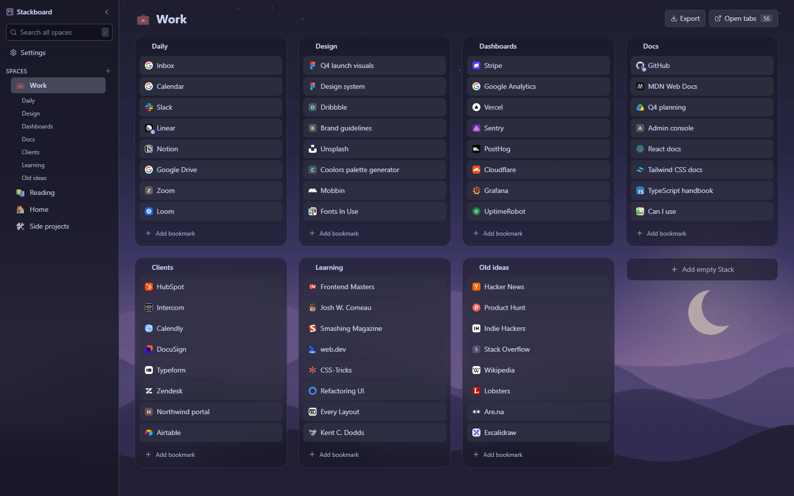

# Stackboard

Your Chrome bookmarks as a board on the new tab page. Spaces down the side, stacks of links across, and you can drag anything anywhere.

**[Get it free on the Chrome Web Store](https://chromewebstore.google.com/detail/bgcedhchngcopaefchpkbhioagknnpma?utm_source=github&utm_medium=readme&utm_campaign=oss)** &nbsp; Website and guides: **[getstackboard.com](https://getstackboard.com)**



## What it does

- **Themes:** Catppuccin (Latte and Mocha), Gruvbox (light and dark), Nord, Tokyo Night (Night and Day), Rosé Pine (main and Dawn), Dracula, and the cream default with a dark version, all in their official colors, plus a true black for OLED screens. Light, dark or follow your system, plus gradients or your own wallpaper with dim and blur. Compact density for big boards, and keys 1 to 9 switch spaces.
- **First run:** copies your bookmarks bar and its folders into a board, one stack per folder. Your originals stay where they are. No bookmarks yet? Pick a starter pack.
- **Drag everything:** spaces, stacks and links, within and across stacks.
- **Undo every delete** with the toast or Ctrl+Z. Chrome has no trash for bookmarks, so this matters.
- **Cards are real links:** Ctrl+click, middle-click and the right-click menu work the way your browser already does. A dot marks links that are already open, and clicking one jumps to that tab.
- **Search every space** from the sidebar (press `/`).
- **Stash this window** (Alt+Shift+S or the toolbar popup): saves every open tab as a stack, one per tab group, and can close them. Open the stack later and they come back as a tab group.
- **Tab bankruptcy** (toolbar popup, under Stash this window): stashes every tab in every window, closes them all and gives you a certificate you can save as an image.
- **To-do lists (Pro):** pick To-do list when you add a stack and it sits on the board with your links. Enter adds an item, checked items sink to the bottom, and Clear done tidies up.
- **Save selected tabs:** Ctrl or Shift+click a few tabs in the tab strip, open the toolbar popup, and one tap on a stack saves them all.
- **Folders inside stacks:** a stack can hold folders, and they open and close in place.
- **Packed layout:** closes the gaps under short stacks (Settings > Appearance > Layout).
- **Share a stack as a link:** the links travel inside the link itself, after the #, which browsers never send to a server.
- **Go links:** type `go`, a space and part of a link's name in the address bar to open it.
- **Teams:** IT can add company spaces and an announcement line through Chrome policy. They show read-only next to your own spaces.
- **Stackboard Pro (optional, $4.99 a year, with a 14-day trial in Settings):** to-do lists, auto-archive for idle tabs, daily snapshots of your board, more looks, clean-up (duplicates, links you never open, sites that no longer load), due dates and repeats with a Today list, and AI tidy with a paid key.
- **Nothing fails silently:** if a bookmark write fails, a message says what went wrong.

## Where your data lives

Everything is plain Chrome bookmarks under **Other bookmarks → Stackboard** (space folders, then stack folders, then bookmarks). So it syncs through Chrome sync, works offline, and if you uninstall the extension your bookmarks stay put.

Coming from another tool? See [Stackboard as a OneTab alternative](https://getstackboard.com/onetab-alternative) or [as a Toby alternative](https://getstackboard.com/toby-alternative), and the [Catppuccin, Gruvbox and Nord themes](https://getstackboard.com/themes).

To-do items are the one exception: they live in Chrome's extension sync storage, so they sync through Chrome with your extension settings, and uninstalling Stackboard deletes them. Each list keeps one bookmark in its stack folder so every device knows which list goes where.

No account and no analytics, and the free extension contacts no server. A few preferences (last space opened, your theme, whether you've answered the one-time rating ask) stay in local storage on your device, and a wallpaper you pick stays in the browser's local database on that device.

Pro goes online only for its own features: it checks your license key with Polar, the payment provider, every few days; AI tidy sends one space's link titles and addresses to getstackboard.com, which asks Anthropic's API to sort them, only when you press Tidy; and clean-up's link check asks each site whether it still loads. The [privacy policy](https://getstackboard.com/privacy) has the details.

## Free bookmark tools

Moving tabs out of another app, or cleaning up the bookmarks you already have? These run in your browser at [getstackboard.com/tools](https://getstackboard.com/tools), and your files never leave your computer:

- [OneTab export to bookmarks](https://getstackboard.com/tools/onetab-to-bookmarks): paste OneTab's export and get a bookmarks file, a CSV or a Stackboard backup.
- [Bookmarks to CSV or Excel](https://getstackboard.com/tools/bookmarks-to-csv): folder, title, URL and date added for every bookmark.
- [Duplicate bookmark finder](https://getstackboard.com/tools/duplicate-bookmark-finder): find pages you saved twice and download a clean file.

## Permissions

| Permission | Why |
|---|---|
| `bookmarks` | Read and write the Stackboard folder; read your other folders only when you choose to copy them in |
| `tabs`, `tabGroups` | The "already open" dot, saving the current tab, stashing a window and reopening it as a group |
| `storage` | A few local flags (first-run hints), your appearance settings, your to-do items, and the Pro key and settings |
| `favicon` | Site icons from Chrome's own favicon cache |
| `search` | Go links: when nothing on your board matches, the text goes to your default search engine |

`externally_connectable` lets two getstackboard.com pages talk to the extension: a shared-stack page can add the stack to your board, and the page after checkout hands over your Pro key.

## Build it yourself

```bash
npm install
npm run build
```

Then open `chrome://extensions`, turn on **Developer mode**, click **Load unpacked** and pick the `dist` folder. `npm run dev` gives you hot reload while you work.

## Tests

- **Unit** (pure logic: titles, icons, import and stash planning, the rating rule, and contrast checks for every palette):

  ```bash
  npx esbuild tests/unit.test.ts --bundle --platform=node --format=esm --loader:.css=text --outfile=unit.mjs && node unit.mjs
  ```

- **End to end** in a real browser: Chrome for Testing plus puppeteer-core, because branded Chrome ignores `--load-extension` since Chrome 137. Setup and run instructions are in the header of [tests/e2e.mjs](tests/e2e.mjs).

## Stack

Manifest V3, React 18, TypeScript, Vite with the crxjs plugin, Tailwind 4, Zustand and dnd-kit. Built with Claude Code.

## Thanks

[tokyo51](https://github.com/tokyo51) tracked down why Stackboard froze in Brave (a background tab holding the root-folder lock forever, with failed writes showing nothing) and sent the fix that shipped in 0.5.2.

## License

[MIT](LICENSE)
